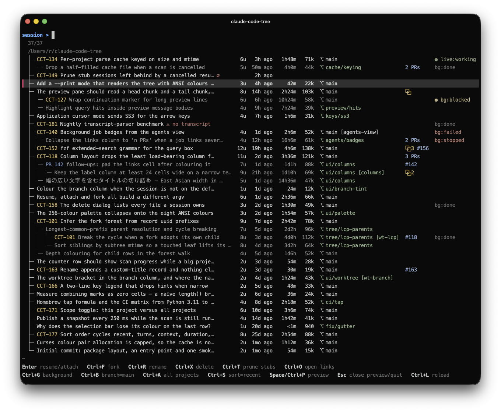

# claude-code-tree

[](https://github.com/rswrz/claude-code-tree/actions/workflows/ci.yml)

A terminal UI over your Claude Code sessions. Forks are shown as a tree, so a
session and everything branched off it stay together. Filter, preview, then
resume, attach, fork, rename, delete or prune.

Python 3.11+, standard library only, no external binaries.



## Install

```
brew install rswrz/tap/claude-code-tree
```

or

```
pipx install git+https://github.com/rswrz/claude-code-tree.git
```

The command is long on purpose; `alias cct='claude-code-tree'` if you type it often.

## Usage

```
claude-code-tree [DIR]                sessions under DIR (default: $PWD)
claude-code-tree --all                start in all-projects scope
claude-code-tree --sort SORT          recent | turns | context | duration | name
claude-code-tree --no-cache           ignore the on-disk transcript cache
claude-code-tree --print [--width N]  render the tree to stdout and exit
claude-code-tree --preview SID        render one session's preview pane and exit
claude-code-tree --version
```

## Keys

| Key | Action |
|---|---|
| Enter | resume session (or attach, if live) |
| Ctrl+F | fork session |
| Ctrl+R | rename session |
| Ctrl+X | delete session |
| Ctrl+T | prune stub sessions |
| Ctrl+O | open links (PRs, artifacts) |
| Ctrl+G | toggle the `bg:` query token |
| Ctrl+B | toggle the current branch as a query token |
| Ctrl+A | toggle scope: this project / all projects |
| Ctrl+S | cycle sort order |
| Ctrl+L | force reload |
| Ctrl+P | toggle preview pane |
| Space | toggle preview pane, or insert a space when the query is not empty |
| Shift+Up/Down | scroll preview |
| PageUp/PageDown | page list or preview |
| Up/Down, Ctrl+J/Ctrl+K | move selection |
| Home/End | jump to top/bottom |
| Ctrl+W / Ctrl+U | delete word / clear query |
| Esc | close preview, else quit |
| Ctrl+C | quit |

## Query syntax

The query box uses fzf's extended-search grammar in `--exact` mode:

- space-separated terms are AND'ed together
- `a|b` is OR within one term group
- `'term` fuzzy match, `^term` prefix, `term$` suffix
- `!term`, `!^term`, `!term$` negate
- case-insensitive unless the query contains an uppercase letter

Titles, metadata and message bodies are all searched.

## Where the data comes from

Sessions are read from `~/.claude/projects/<encoded-cwd>/<session-id>.jsonl`
(or `$CLAUDE_CONFIG_DIR` when set). Background-agent state comes from
`~/.claude/jobs` and `claude agents --json`. Nothing is written to a transcript
except the `custom-title` record a rename appends.

Fork parentage is taken from the daemon when it knows it, and otherwise inferred:
a fork copies its parent's records, so two sessions sharing a long prefix of
record uuids are parent and child.

Parse results are cached at `~/.cache/claude-code-tree/<encoded-project>.json`, keyed on file
size and mtime. Delete it, or pass `--no-cache`, to force a full re-parse.

## Licence

MIT
